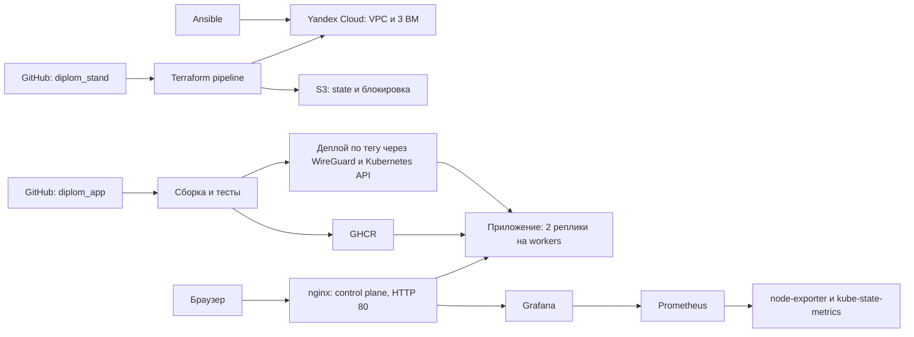

# Дипломный проект DevOps в Yandex Cloud

Самостоятельный Kubernetes-кластер, инфраструктура Terraform, установка Ansible, мониторинг kube-prometheus-stack и CI/CD в GitHub Actions.

| Результат | Ссылка |
|---|---|
| Приложение | [Открыть страницу](http://51.250.69.86/) |
| Grafana | [Веб-интерфейс](http://51.250.69.86/grafana/) · [Обзор Kubernetes](http://51.250.69.86/grafana/d/diplom-overview) |
| Код приложения и Dockerfile | [QLore3/diplom_app](https://github.com/QLore3/diplom_app) |
| Docker image | [Пакет GHCR](https://github.com/QLore3/diplom_app/pkgs/container/diplom_app) · `ghcr.io/qlore3/diplom_app:v1.0.0` |
| Terraform pipeline | [GitHub Actions](https://github.com/QLore3/diplom_stand/actions/workflows/terraform.yml) |
| Сборка и деплой приложения | [GitHub Actions](https://github.com/QLore3/diplom_app/actions/workflows/publish.yml) |

Grafana: логин `admin`. Пароль передаётся преподавателю отдельно и в репозитории не хранится.

## Архитектура



| Нода | Зона | Роль | Прерываемая |
|---|---|---|---|
| `diplom-control` | `ru-central1-a` | control plane, HTTP reverse proxy, WireGuard | нет |
| `diplom-worker1` | `ru-central1-a` | приложения и мониторинг | да |
| `diplom-worker2` | `ru-central1-d` | приложения и мониторинг | да |

Каждая ВМ: **2 vCPU, 2 ГБ RAM, CPU 20%, HDD 10 ГБ**, Ubuntu 24.04, платформа standard-v3. Созданы три подсети (`a`, `b`, `d`); подсеть `b` без ВМ из-за недоступности создания инстансов в этой зоне на момент развёртывания.

Версии: Terraform 1.12.1, Yandex provider 0.244.0, Kubernetes 1.36.6, containerd 2.2.1, Flannel 0.28.10, Helm 3.22.1, kube-prometheus-stack 92.20.0. Провайдер закреплён lock-файлами, CNI и Helm — версиями и контрольными суммами, образ приложения — digest.

## Структура

```text
terraform/bootstrap/    сервисные аккаунты, ключи и S3 backend
terraform/main/         VPC, подсети, security groups и ВМ
ansible/                кластер, платформа, HTTP и доступ CI
kubernetes/app/         приложение и RBAC deployer
kubernetes/monitoring/  Helm values и дашборд
.github/workflows/     Terraform CI/CD
img/                    материалы сдачи
```

## Развёртывание

Рабочее окружение: Linux, Terraform 1.12.1, Python 3 с PyYAML, Ansible Core 2.16+, kubectl 1.36.x, GitHub CLI и SSH-ключ. GitHub CLI должен иметь доступ к Actions, secrets и variables обоих репозиториев; публичный SSH-ключ задаётся в Terraform. Начальная учётная запись Yandex Cloud должна уметь создавать сервисные аккаунты и назначать роли в выделенном каталоге. Облако, каталог и активный биллинг подготавливаются заранее.

Все команды ниже выполняются из корня `diplom_stand`. Рабочие ключи, tfvars, backend config и state исключены из Git. Примеры содержат placeholders, которые заполняются один раз для своего окружения.

### 1. Backend и ограниченные учётные записи

```bash
umask 077
mkdir -p .local
export PATH="$PWD/.local/bin:$PATH"
export GH_CONFIG_DIR="$PWD/.local/gh"
# Для первоначальной настройки GitHub: gh auth login
cp terraform/bootstrap/bootstrap.example.tfvars terraform/bootstrap/terraform.tfvars
# Заполнить cloud_id, folder_id, bootstrap_key_file и bucket_name.
terraform -chdir=terraform/bootstrap init -lockfile=readonly
terraform -chdir=terraform/bootstrap plan -out="$PWD/.local/bootstrap.tfplan"
terraform -chdir=terraform/bootstrap apply "$PWD/.local/bootstrap.tfplan"
terraform -chdir=terraform/bootstrap output -json infra_key > .local/infra-key.json
terraform -chdir=terraform/bootstrap output -json backend_credentials > .local/backend-credentials.json
```

Bootstrap state хранится локально и содержит секреты: его нужно сохранять с правами 600 вне Git. Аккаунт `tf-infra` получает только `compute.editor` и `vpc.admin` в каталоге. Аккаунт `tf-backend` получает READ/WRITE ACL только на bucket state; у него нет ролей на весь каталог. Bucket закрыт, с versioning, S3 lockfile и `prevent_destroy`.

### 2. Основная инфраструктура

```bash
cp terraform/main/main.example.tfvars terraform/main/terraform.tfvars
cp terraform/main/backend.example.hcl .local/backend.hcl
# Заполнить параметры окружения и имя bucket; infra_key_file — абсолютный путь к .local/infra-key.json.
export AWS_ACCESS_KEY_ID="$(python3 -c 'import json; print(json.load(open(".local/backend-credentials.json"))["access_key"])')"
export AWS_SECRET_ACCESS_KEY="$(python3 -c 'import json; print(json.load(open(".local/backend-credentials.json"))["secret_key"])')"
export AWS_EC2_METADATA_DISABLED=true
terraform -chdir=terraform/main init -lockfile=readonly -backend-config="$PWD/.local/backend.hcl"
terraform -chdir=terraform/main plan -out="$PWD/.local/main.tfplan"
terraform -chdir=terraform/main apply "$PWD/.local/main.tfplan"
terraform -chdir=terraform/main output -json nodes
```

`admin_cidr` — внешний IPv4/CIDR рабочего окружения: SSH/22 и API/6443 принимают соединения только с него. HTTP/80 публичный. UDP/51820 используется аутентифицированным WireGuard; после расшифровки разрешён только API, SSH и транзит в VPC запрещены. При изменении административного IP обновить `admin_cidr` также в `TF_VARS_JSON` GitHub.

### 3. Kubernetes, мониторинг и доступ CI

```bash
export KUBECONFIG="$PWD/.local/kubeconfig"
ansible-galaxy collection install -r ansible/requirements.yml
(cd ansible && ansible-playbook site.yml)
mkdir -p "$HOME/.kube"
install -m 600 .local/kubeconfig "$HOME/.kube/config"
(cd ansible && ansible-playbook platform.yml)
(cd ansible && ansible-playbook delivery.yml)
kubectl get nodes -o wide
kubectl get pods --all-namespaces
```

Inventory получает адреса из Terraform outputs; S3 credentials берутся из окружения либо `.local/backend-credentials.json`. `site.yml` ожидает готовности SSH и cloud-init. Кластер использует частные адреса ВМ, а внешний адрес API добавляется в сертификат и локальный kubeconfig автоматически.

`platform.yml` устанавливает Helm, kube-prometheus-stack, приложение и nginx на control plane. Пароль Grafana восстанавливается из существующего Secret либо генерируется в `.local/grafana-admin-password` (600); при пересоздании кластера локальный пароль сохраняется. URL Grafana и upstream ClusterIP вычисляются автоматически. Повторное применение платформы сохраняет текущий образ, выпущенный через CD.

`delivery.yml` настраивает WireGuard и клиентский сертификат deployer, экспортирует `.local/delivery/wg-ci.conf` и `.local/delivery/kubeconfig` (600). RBAC разрешает get/list/watch/patch только Deployment `app/diplom-app`; namespace использует Pod Security Restricted. Сертификат действует 30 дней: повторный запуск обновит его, когда остаётся меньше 7 дней. После пересоздания кластера либо обновления сертификата нужно выполнить команды загрузки secrets ниже.

### 4. GitHub Actions

В `diplom_stand` задаются Secrets `YC_SA_KEY_JSON`, `AWS_ACCESS_KEY_ID`, `AWS_SECRET_ACCESS_KEY`; Variables `TF_STATE_BUCKET`, `TF_VARS_JSON`. JSON-переменная содержит параметры основной инфраструктуры, но не ключи; путь `infra_key_file` workflow задаёт сам. Bootstrap-ключ в CI не передаётся.

- PR внутри репозитория: fmt, validate и plan; fork/Dependabot не получают облачные credentials.
- Каждый push в `main`: plan → apply сохранённого плана → no-drift check.
- Ручной запуск поддерживает `plan`/`apply`; автоматического destroy нет.
- Cloud jobs сериализованы; plan/state/credentials не публикуются как artifacts.

В репозитории `diplom_app`:

```bash
gh secret set WIREGUARD_CONFIG --repo QLore3/diplom_app < .local/delivery/wg-ci.conf
gh secret set DELIVERY_KUBECONFIG --repo QLore3/diplom_app < .local/delivery/kubeconfig
CONTROL_IP="$(terraform -chdir=terraform/main output -json nodes | python3 -c 'import json,sys; print(json.load(sys.stdin)["control"]["public_ip"])')"
gh variable set PUBLIC_APP_URL --repo QLore3/diplom_app --body "http://$CONTROL_IP"
```

Каждый push в любую ветку приложения собирает и проверяет контейнер, публикует SHA image в GHCR; `main` также обновляет `latest`. Тег `vX.Y.Z` публикует одноимённый image tag и запускает деплой по digest. Проверяются rollout, публичный `/healthz` и точные версия/commit `/version.json`; при ошибке возвращается предыдущий образ. Деплои сериализованы. Все сборки выполняются на GitHub-hosted runner, дополнительных ВМ для CI нет.

## Восстановление с нуля

Реально проверено 06.11.2026 ([Terraform pipeline восстановления](https://github.com/QLore3/diplom_stand/actions/runs/42176633629)): удалена **вся main-инфраструктура (9 ресурсов)**, S3 backend и bootstrap сохранены; Terraform pipeline заново создал сеть и три ВМ, Ansible восстановил кластер, мониторинг и доступ CI, workflow приложения развернул `v1.0.0`. Публичные IP и CA кластера могут изменяться; inventory, kubeconfig, URL и CI credentials пересоздаются командами выше.

Для повторной демонстрации подготовить сохранённые локальные ключи/настройки и авторизацию GitHub, затем:

```bash
# Временно удаляет ВМ, сеть и всё содержимое кластера.
terraform -chdir=terraform/main plan -destroy -out="$PWD/.local/destroy.tfplan"
terraform -chdir=terraform/main apply "$PWD/.local/destroy.tfplan"
gh workflow run terraform.yml --repo QLore3/diplom_stand --ref main -f operation=apply
# Дождаться успешного run, затем выполнить разделы 3 и 4.
gh workflow run publish.yml --repo QLore3/diplom_app --ref v1.0.0
```

После смены IP проверить SSH host keys; при повторном выделении старого IP доверять новому ключу только после подтверждения пересоздания своей ВМ. История Prometheus и пользовательские изменения Grafana хранятся в `emptyDir` и при пересоздании теряются; дашборды из Git и пароль восстанавливаются.

## Проверки и материалы сдачи

[Успешный деплой после пересоздания кластера](https://github.com/QLore3/diplom_app/actions/runs/42178255099).

Проверены: три ноды Ready без pressure, DNS и Service между зонами, две реплики приложения на разных workers, health/version и исходная GIF, Grafana и datasource, 22 targets UP, метрики CPU/RAM/дисков всех трёх нод, отказ недоступного образа с откатом, повторный Ansible без изменений и Terraform без drift.

| Требование задания | Результат |
|---|---|
| Terraform и создание ресурсов с нуля | [bootstrap](terraform/bootstrap), [main](terraform/main); реальный destroy/apply проверен |
| Terraform pipeline | [Workflow](.github/workflows/terraform.yml), снимки ниже |
| Ansible | [Конфигурация кластера и платформы](ansible) |
| Dockerfile и image | [Dockerfile](https://github.com/QLore3/diplom_app/blob/main/Dockerfile), `ghcr.io/qlore3/diplom_app:v1.0.0` |
| Kubernetes-конфигурация | [Приложение](kubernetes/app), [мониторинг](kubernetes/monitoring) |
| Приложение и Grafana | Ссылки в начале README; пароль Grafana передаётся отдельно |
| Единый Git-хостинг | Оба репозитория размещены на GitHub |

Снимки фиксируют проверки на предыдущих этапах; после проверки восстановления внешние IP могли измениться. Актуальные адреса указаны в начале README.


## Ограничения и завершение

Это учебный стенд с одним control plane и прерываемыми workers, без высокой доступности. Приложение и Grafana опубликованы по HTTP/80 без домена. Prometheus хранит 6 часов/512 МБ метрик; Prometheus и Grafana используют временное хранилище. Control plane не принимает обычные pod’ы приложения. Стенд остаётся включённым до команды владельца.

Для удаления после защиты используется destroy **только `terraform/main`**. Перед очисткой нужно отключить автоматический apply workflow, иначе новый push в `main` создаст ресурсы снова. Bootstrap удаляется отдельно после сохранения нужных state/материалов, отзыва ключей и осознанного снятия защиты bucket; он не входит в обычную демонстрацию destroy/apply.
