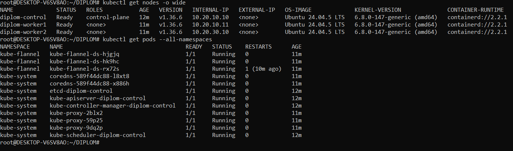
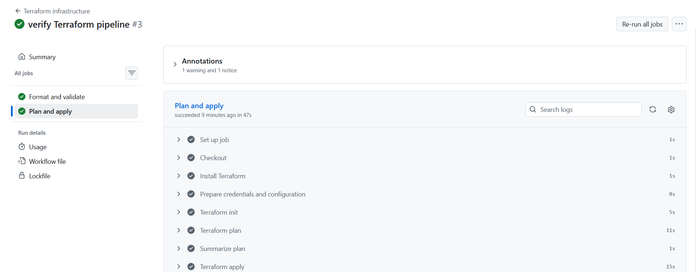
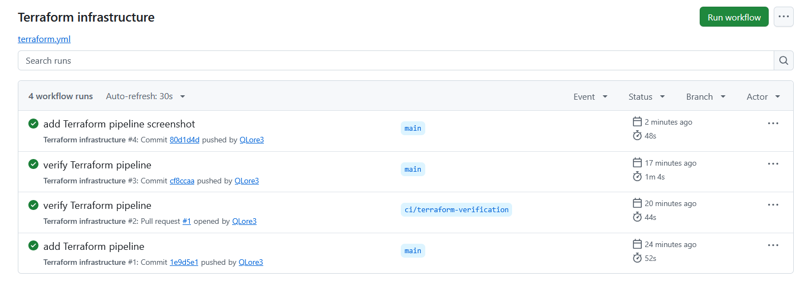

# Дипломный стенд DevOps

## Этап 1 — облачная инфраструктура

В Yandex Cloud созданы сервисные аккаунты с ограниченными правами, закрытый S3 bucket для Terraform state с версионированием и блокировкой, отдельная VPC, три подсети и три ВМ.

- Control plane — непрерываемая ВМ; два worker — прерываемые.
- Каждая ВМ: 2 vCPU, 2 ГБ RAM, CPU 20%, HDD 10 ГБ, Ubuntu 24.04.
- SSH и Kubernetes API ограничены административным CIDR.
- Проверены SSH, внутренняя связь, доступ к GHCR и отсутствие изменений при повторном Terraform plan.

`terraform/bootstrap` — аккаунты и backend, `terraform/main` — сеть и ВМ. Параметры описаны в `variables.tf`; примеры настроек — в `*.example.tfvars`. Рабочие `terraform.tfvars`, ключи и state в Git не хранятся. При инициализации main настройки S3 передаются через `terraform init -backend-config=...`, credentials — через окружение.

ВМ размещены в зонах `a` и `d`: создание ВМ в `b` недоступно, подсеть `b` сохранена без ВМ. Полный цикл destroy/apply проверим на заключительном этапе.

Приложение: [diplom_app](https://github.com/QLore3/diplom_app), registry — GHCR. Приложение и мониторинг опубликованы на этапе 4.

## Этап 2 — Kubernetes

Ansible устанавливает Kubernetes 1.36.6 через kubeadm, containerd 2.2.1 и Flannel 0.28.10. Inventory получает адреса из Terraform outputs; версии и параметры кластера заданы в `ansible/group_vars/all.yml`.

```bash
cd ansible
ansible-playbook site.yml
```

Для доступа к S3 state используются переменные `AWS_ACCESS_KEY_ID`/`AWS_SECRET_ACCESS_KEY` либо локальный `.local/backend-credentials.json`. Kubeconfig создаётся в `.local/kubeconfig`; на рабочей машине также установлен в `~/.kube/config`. Ключ SSH должен быть доступен через стандартный путь или ssh-agent.

Проверены три ноды Ready, системные pod'ы, DNS, Service и связь pod'ов между зонами. Повторный запуск Ansible не вносит изменений. Конфигурации доступа, токены и логи в Git не хранятся.

Результат проверки нод и системных pod'ов:



## Этап 3 — тестовое приложение

В [diplom_app](https://github.com/QLore3/diplom_app) подготовлены статическая страница с интерактивной схемой стенда, версией релиза и танцующим котиком, собственный Dockerfile и конфигурация nginx.

Публичный образ: `ghcr.io/qlore3/diplom_app:latest`. [Сборка и публикация в GitHub Actions](https://github.com/QLore3/diplom_app/actions/runs/42068945518) прошли успешно. Проверены контейнер без root, HTTP, healthcheck и адаптивный интерфейс. Приложение развёрнуто в Kubernetes на этапе 4.

## Этап 4 — мониторинг и публикация

- [Приложение](http://51.250.73.107/) — две реплики на разных workers, образ закреплён по digest.
- [Grafana](http://51.250.73.107/grafana/) и [обзор кластера](http://51.250.73.107/grafana/d/diplom-overview) — публичный HTTP/80 через nginx на control plane. Логин `admin`, пароль передаётся отдельно и в Git не хранится.
- Мониторинг: kube-prometheus-stack 92.20.0 (Helm-сборка kube-prometheus), Prometheus Operator, Prometheus, Alertmanager, Grafana, kube-state-metrics и node-exporter. Проверены 22 targets UP, метрики трёх нод и 26 дашбордов.

Конфигурации находятся в `kubernetes/app` и `kubernetes/monitoring`; развёртывание — `ansible-playbook platform.yml` из `ansible` (коллекция из `requirements.yml`). Повторный запуск не вносит изменений. История Prometheus ограничена 6 часами и 512 МБ; хранилище метрик и Grafana временное. Ресурсы ВМ не увеличивались.

## Terraform pipeline

`.github/workflows/terraform.yml`: fmt/validate для PR, plan для PR внутри репозитория; при каждом push в `main` — plan, apply сохранённого плана и проверка отсутствия drift. Запуски main сериализованы, state и блокировка находятся в S3. Bootstrap в pipeline не запускается; plan и credentials не загружаются в artifacts.

Actions Secrets: `YC_SA_KEY_JSON`, `AWS_ACCESS_KEY_ID`, `AWS_SECRET_ACCESS_KEY`. Variables: `TF_VARS_JSON` (публичные Terraform-параметры в JSON), `TF_STATE_BUCKET`. PR из fork получают только проверки без облачных credentials. Ручной запуск поддерживает `plan` и `apply` для `main`.

Успешный запуск Terraform pipeline:



История успешных запусков для PR и push в main:


